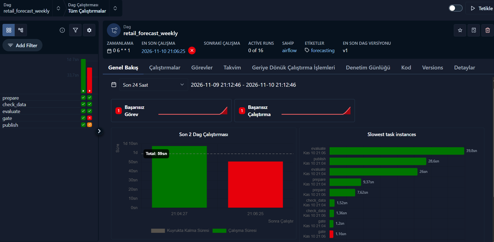

# Retail Demand Forecasting and Inventory Agent

Daily demand forecasts and service-level based order recommendations for a Walmart store, exposed to AI agents through an MCP server.

The project uses the [M5 dataset](https://www.kaggle.com/competitions/m5-forecasting-accuracy) (store `CA_1`, department `FOODS_3`, 823 items, May 2013 to May 2016). Every model is checked with a rolling-origin backtest over 3 periods of 28 days, and nothing after a cutoff day is used to forecast that period.

## Results

### Demand forecast (28 days ahead)

The same forecasts are measured at three levels. Mean of 3 periods

| Level | Baseline WAPE | LightGBM WAPE |
|---|---|---|
| Item x day | 63.0% | **60.0%** |
| Item x week | 33.3% | **33.0%** |
| Store total x day | 17.4% | **7.4%** |
| Total forecast / total sales | 0.96 | 0.94 |

- LightGBM is better than a 28-day moving average at every level and in all 3 periods for item x day.
- On the store total the daily error drops from 17.4% to 7.4%.
- 60% at item x day level is expected. A single item sells 0, 1 or 2 units on most days, and this noise averages out when forecasts are summed.

### Stock level (14 days = 7 days lead time + 7 days review period)

| Method | Demand covered | Excess stock / demand |
|---|---|---|
| Classic formula, z = 1.645 (promises 95%) | 81.2% | 33.7% |
| Classic formula, z = 3.0 | 90.8% | 57.3% |
| LightGBM quantile, target 80% | 80.8% | 29.6% |
| LightGBM quantile, target 90% | 90.3% | 45.0% |
| LightGBM quantile, target 95% | 95.4% | 59.9% |

- The textbook safety stock formula assumes normally distributed demand. Here almost half of the days have zero sales, so it reaches only 81% instead of 95%.
- Quantile models hit their targets (80.8%, 90.3%, 95.4%).
- At about 90% service level they keep **about 21% less excess stock** than the classic formula.

## Approach

**Data preparation** (`src/prepare_data.py`)
Wide daily sales are turned into one row per item per day and joined with the calendar and weekly prices. Days without a price mean the item was not on the shelf, so they are removed instead of being treated as zero demand.

**Baseline and backtest** (`src/backtest.py`)
3 cutoffs, 28 days apart. The baseline is the mean of the last 28 days. WAPE is the main metric because MAPE breaks on zero-sales days.

**Forecast model** (`src/train_lgbm.py`)
Direct multi-horizon LightGBM. Features are computed as of the cutoff day (recent means, zero share, same-weekday mean, planned price, SNAP and event days) together with the horizon (1 to 28). Training rows come from weekly past cutoffs, so the model learns in exactly the situation it is used in.

Two problems were found and fixed on the way.

1. A first version with lag features beat the baseline by only 1%. The lags were older than the information the baseline used, and the item id feature led to overfitting. The direct approach fixed both.
2. An L1 objective gave the best item x day WAPE (57.9%), but it predicts the median. Summed over days its forecasts were 25% below real sales, and it lost to the baseline on weekly and store totals. A Poisson objective predicts the mean and wins at every level, so it is used instead.

**Stock model** (`src/inventory.py`)
LightGBM with a quantile objective predicts the 14-day demand that is enough in 80, 90 or 95% of cases. It is backtested against the classic `z * std * sqrt(days)` formula.

**Batch job and MCP server** (`src/build_artifacts.py`, `src/mcp_server.py`)
The batch job trains the models as of 2016-04-24 and saves forecasts and stock levels. It also makes sure the 80/90/95% levels never cross. The MCP server reads these files and answers instantly.

## MCP tools

| Tool | What it does |
|---|---|
| `find_items` | Lists best sellers or items with a possible empty shelf |
| `get_forecast` | Daily forecast for the next 1 to 28 days |
| `recommend_order` | Order quantity for a given stock on hand and service level |

Example response of `recommend_order("FOODS_3_002", on_hand=0, service_level=90)`

```json
{
  "item_id": "FOODS_3_002",
  "covers_days": 14,
  "expected_demand": 16.1,
  "target_stock": 28.3,
  "order_quantity": 29,
  "warning": "No sales in the last 28 days although the item sold 1.9 per day over the last 112 days. Possible stockout, check the shelf."
}
```

This item sold about 20 units a week, then had 8 weeks of zero sales, then sold again. The zeros were an empty shelf, not missing demand, and the tool flags this kind of case.

## Scaling with PySpark on Databricks

`databricks/01_spark_features.ipynb` moves data preparation and feature engineering to PySpark.

1. The single store pipeline is rebuilt with `unpivot`, joins and window functions.
2. The Spark output is checked against the pandas version and matches exactly (902,008 rows, 2,398,726 units sold, same rolling means on 2016-04-24).
3. The same code then runs on all 10 stores and 3,049 items, which is 30,490 series and 33.4 million rows. The rolling features take about 20 seconds.

Results are saved as Delta tables (`sales_long_all`, `features_all`).

## Retailer onboarding agent

A new customer's data never arrives in our format. `skills/retailer-onboarding/SKILL.md` is an agent workflow that profiles the raw files, maps them to our data model, finds data problems and builds the standard table. The agent does the checks, and the analyst makes every decision about how to fix the data.

The workflow uses the `retailer-onboarding` MCP server (`src/onboarding_server.py`).

| Tool | What it does |
|---|---|
| `list_files` | Lists the files a retailer sent |
| `profile_file` | Columns, guessed types, date formats, decimal commas, ranges, examples |
| `check_mapping` | Applies a column mapping and returns conversion problems and data issues |
| `build_standard_table` | Writes the data in our model format using the analyst's decisions |

**Test case.** `src/make_sample_retailer.py` turns store TX_1 / FOODS_1 into a messy export with other column names, `dd.mm.yyyy` dates, decimal comma prices and five hidden problems. The checks find all of them.

| Hidden problem | Found |
|---|---|
| 3 days missing from the export | `missing_days` 3, with the exact dates |
| 60 rows exported twice | `duplicate_rows` 60 |
| 25 returns as negative sales | `negative_sales` 25 |
| 12 items without any price | `items_without_price` 12 |
| 8 prices entered as 0 | `zero_or_negative_prices` 8 |

The tools can only read files under `data/onboarding/<retailer>/`.

## Weekly pipeline with Airflow

`dags/retail_forecast_dag.py` runs the pipeline every Monday at 06:00, before the weekly orders. Each task runs one step of `src/pipeline.py`.

```
prepare -> check_data -> evaluate -> gate -> publish
```

- `check_data` stops the run on duplicate rows, missing days or negative sales.
- `evaluate` backtests the model on the latest 28 days and saves the metrics.
- `gate` publishes only if the model beats the baseline at store level **and** the total forecast is within 15% of real sales.
- `publish` writes the files the MCP server reads, so a failed gate leaves the last good forecasts in place.

The model type is a DAG parameter, which makes the gate easy to test. The first run below uses the Poisson model and passes. The second uses the old L1 model, whose total forecast was 74% of real sales. The gate stops it and `publish` never runs. This is the same bias that was found by hand earlier, now caught automatically.



## How to run

```
python -m venv .venv
.venv\Scripts\activate
pip install -r requirements.txt
```

1. Download the M5 data from Kaggle and extract it into `data/raw/`
2. Run the steps

```
python src/prepare_data.py     # build data/processed/sales.parquet
python src/backtest.py         # baseline backtest
python src/train_lgbm.py       # LightGBM vs baseline (about 2 minutes)
python src/inventory.py        # stock level backtest
python src/build_artifacts.py  # save forecasts and stock levels for the server
```

3. For the Spark version, upload `calendar.csv`, `sales_train_evaluation.csv` and `sell_prices.csv` to the Databricks volume `/Volumes/workspace/default/m5` and run the notebook in `databricks/`

4. Add the server to any MCP client that supports stdio

```json
{
  "mcpServers": {
    "retail-forecast": {
      "command": "C:\\dev\\retail-forecast\\.venv\\Scripts\\python.exe",
      "args": ["C:\\dev\\retail-forecast\\src\\mcp_server.py"]
    },
    "retailer-onboarding": {
      "command": "C:\\dev\\retail-forecast\\.venv\\Scripts\\python.exe",
      "args": ["C:\\dev\\retail-forecast\\src\\onboarding_server.py"]
    }
  }
}
```

5. For onboarding, run `python src/make_sample_retailer.py`, then ask the agent to follow `skills/retailer-onboarding/SKILL.md` for `retailer_x`

6. For Airflow (Linux or WSL), install `apache-airflow==3.4.0` in its own environment, point `AIRFLOW__CORE__DAGS_FOLDER` to `dags/` and set `RETAIL_FORECAST_DIR` and `RETAIL_FORECAST_PYTHON` if the project or its Python live somewhere else

```
airflow dags test retail_forecast_weekly                                  # full run
airflow dags test retail_forecast_weekly -c '{"model_objective": "l1"}'   # the gate stops this one
```

## Project structure

```
src/
  prepare_data.py     raw M5 files -> long parquet
  backtest.py         folds, baseline, metrics
  train_lgbm.py       direct multi-horizon forecast
  inventory.py        quantile stock model vs classic formula
  build_artifacts.py  batch job for the server
  mcp_server.py       MCP tools
  make_sample_retailer.py  messy test export for onboarding
  onboarding.py            profiling, mapping and data checks
  onboarding_server.py     onboarding MCP tools
  pipeline.py              pipeline steps and validation gate
dags/
  retail_forecast_dag.py   weekly Airflow DAG
skills/
  retailer-onboarding/SKILL.md  agent workflow for a new retailer
databricks/
  01_spark_features.ipynb  PySpark version of data preparation and features, all 10 stores
```

